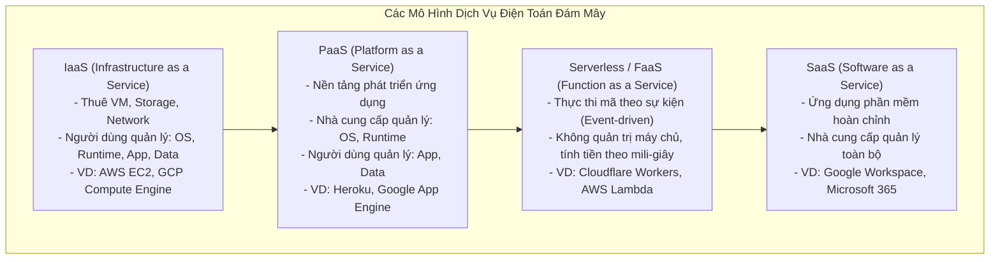
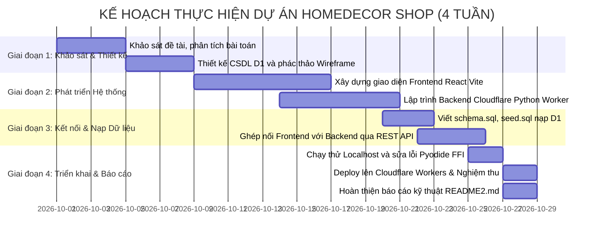
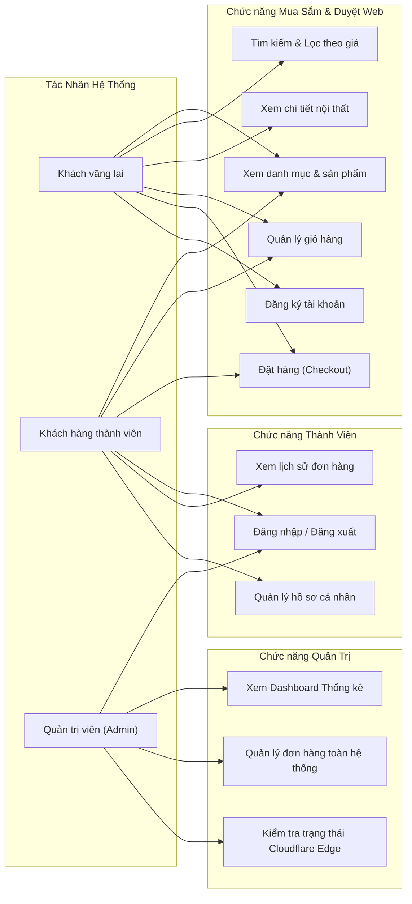
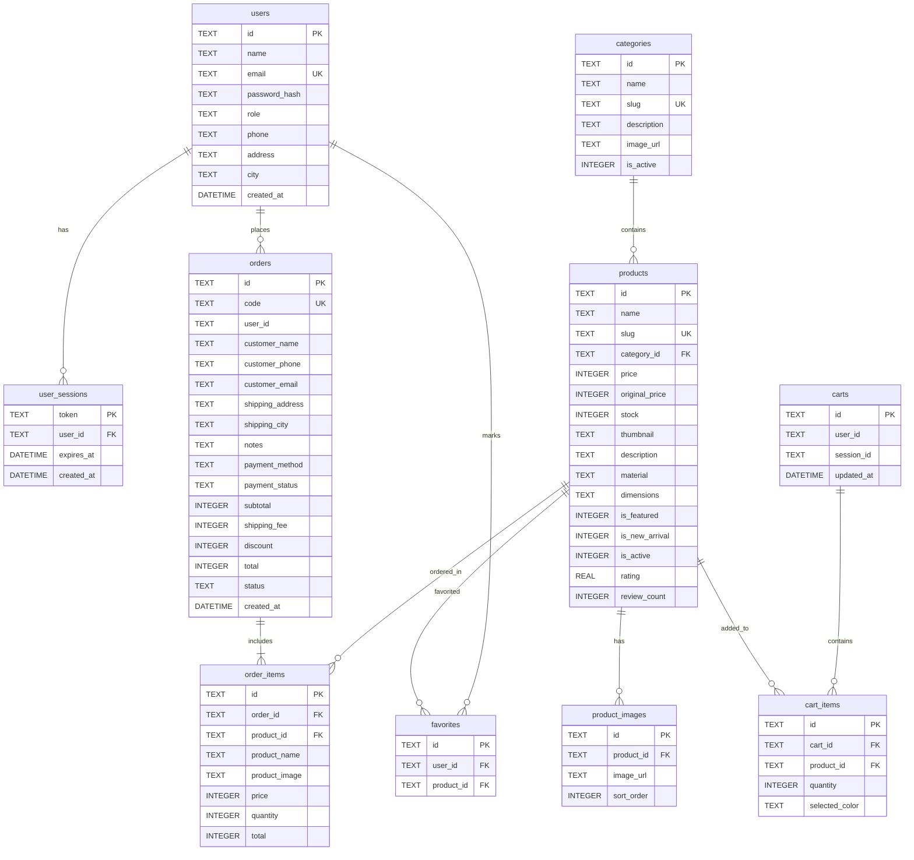
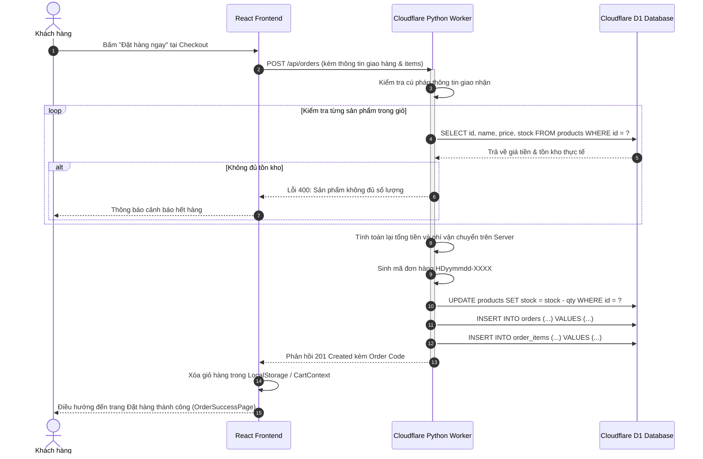

# BÁO CÁO TIỂU LUẬN / ĐỒ ÁN MÔN HỌC: ĐIỆN TOÁN ĐÁM MÂY (CLOUD COMPUTING)

---

## ĐỀ TÀI: PHÂN TÍCH, THIẾT KẾ VÀ TRIỂN KHAI HỆ THỐNG THƯƠNG MẠI ĐIỆN TỬ NỘI THẤT CAO CẤP (HOMEDECOR SHOP) TRÊN NỀN TẢNG SERVERLESS CLOUDFLARE WORKERS VÀ CLOUDFLARE D1 DATABASE

* **Mã học phần:** Điện toán đám mây
* **Sản phẩm nghiệm thu (Production URL):** [https://homedecor-shop.dtc235200750.workers.dev](https://homedecor-shop.dtc235200750.workers.dev)
* **API Health Check:** [https://homedecor-shop.dtc235200750.workers.dev/api/health](https://homedecor-shop.dtc235200750.workers.dev/api/health)
* **Môi trường Serverless:** Cloudflare Edge Anycast Global Network (APAC Region)

---

# MỤC LỤC CHI TIẾT

- [CHƯƠNG 1. TỔNG QUAN VỀ ĐỀ TÀI VÀ DỊCH VỤ ĐIỆN TOÁN ĐÁM MÂY](#chương-1-tổng-quan-về-đề-tài-và-dịch-vụ-điện-toán-đám-mây)
  - [1.1. Giới thiệu đề tài](#11-giới-thiệu-đề-tài)
    - [1.1.1. Lý do lựa chọn đề tài](#111-lý-do-lựa-chọn-đề-tài)
    - [1.1.2. Mục tiêu của đề tài](#112-mục-tiêu-của-đề-tài)
    - [1.1.3. Phạm vi nghiên cứu và thực hiện](#113-phạm-vi-nghiên-cứu-và-thực-hiện)
  - [1.2. Phân tích bài toán website thương mại điện tử](#12-phân-tích-bài-toán-website-thương-mại-điện-tử)
    - [1.2.1. Mô tả bài toán](#121-mô-tả-bài-toán)
    - [1.2.2. Dữ liệu đầu vào (Input)](#122-dữ-liệu-đầu-vào-input)
    - [1.2.3. Dữ liệu đầu ra (Output)](#123-dữ-liệu-đầu-ra-output)
    - [1.2.4. Các yêu cầu chức năng và phi chức năng](#124-các-yêu-cầu-chức-năng-và-phi-chức-năng)
  - [1.3. Tổng quan về điện toán đám mây](#13-tổng-quan-về-điện-toán-đám-mây)
    - [1.3.1. Khái niệm điện toán đám mây](#131-khái-niệm-điện-toán-đám-mây)
    - [1.3.2. Các mô hình dịch vụ điện toán đám mây](#132-các-mô-hình-dịch-vụ-điện-toán-đám-mây)
    - [1.3.3. Lợi ích của việc triển khai website trên Public Cloud](#133-lợi-ích-của-việc-triển-khai-website-trên-public-cloud)
  - [1.4. Giới thiệu nền tảng Cloudflare](#14-giới-thiệu-nền-tảng-cloudflare)
    - [1.4.1. Tổng quan về Cloudflare](#141-tổng-quan-về-cloudflare)
    - [1.4.2. Dịch vụ Cloudflare Workers](#142-dịch-vụ-cloudflare-workers)
    - [1.4.3. Dịch vụ Cloudflare D1](#143-dịch-vụ-cloudflare-d1)
    - [1.4.4. Workers Static Assets](#144-workers-static-assets)
    - [1.4.5. Lý do lựa chọn Cloudflare](#145-lý-do-lựa-chọn-cloudflare)
  - [1.5. Phân công công việc và kế hoạch thực hiện](#15-phân-công-công-việc-và-kế-hoạch-thực-hiện)
    - [1.5.1. Phân công nhiệm vụ trong nhóm](#151-phân-công-nhiệm-vụ-trong-nhóm)
    - [1.5.2. Kế hoạch thực hiện mini-project](#152-kế-hoạch-thực-hiện-mini-project)
    - [1.5.3. Công cụ và công nghệ sử dụng](#153-công-cụ-và-công-nghệ-sử-dụng)
- [CHƯƠNG 2. PHÂN TÍCH, THIẾT KẾ VÀ TRIỂN KHAI WEBSITE TRÊN CLOUDFLARE](#chương-2-phân-tích-thiết-kế-và-triển-khai-website-trên-cloudflare)
  - [2.1. Phân tích và thiết kế hệ thống](#21-phân-tích-và-thiết-kế-hệ-thống)
    - [2.1.1. Kiến trúc tổng thể của website](#211-kiến-trúc-tổng-thể-của-website)
    - [2.1.2. Xác định các tác nhân và chức năng](#212-xác-định-các-tác-nhân-và-chức-năng)
    - [2.1.3. Sơ đồ Use Case tổng quát](#213-sơ-đồ-use-case-tổng-quát)
    - [2.1.4. Thiết kế cơ sở dữ liệu](#214-thiết-kế-cơ-sở-dữ-liệu)
    - [2.1.5. Quy trình xử lý đặt hàng](#215-quy-trình-xử-lý-đặt-hàng)
  - [2.2. Xây dựng website thương mại điện tử](#22-xây-dựng-website-thương-mại-điện-tử)
    - [2.2.1. Xây dựng giao diện Frontend bằng HTML, CSS, JavaScript](#221-xây-dựng-giao-diện-frontend-bằng-html-css-javascript)
    - [2.2.2. Xây dựng Backend bằng Python Workers](#222-xây-dựng-backend-bằng-python-workers)
    - [2.2.3. Thiết kế các API xử lý nghiệp vụ](#223-thiết-kế-các-api-xử-lý-nghiệp-vụ)
    - [2.2.4. Kết nối hệ thống với Cloudflare D1](#224-kết-nối-hệ-thống-với-cloudflare-d1)
  - [2.3. Triển khai website trên nền tảng Cloudflare](#23-triển-khai-website-trên-nền-tảng-cloudflare)
    - [2.3.1. Chuẩn bị môi trường phát triển](#231-chuẩn-bị-môi-trường-phát-triển)
    - [2.3.2. Đăng ký và cấu hình tài khoản Cloudflare](#232-đăng-ký-và-cấu-hình-tài-khoản-cloudflare)
    - [2.3.3. Tạo cơ sở dữ liệu Cloudflare D1](#233-tạo-cơ-sở-dữ-liệu-cloudflare-d1)
    - [2.3.4. Cấu hình tệp wrangler.toml](#234-cấu-hình-tệp-wranglertoml)
    - [2.3.5. Kết nối Python Workers với D1](#235-kết-nối-python-workers-với-d1)
    - [2.3.6. Chạy thử website trên môi trường Local](#236-chạy-thử-website-trên-môi-trường-local)
    - [2.3.7. Triển khai website lên Cloudflare Workers](#237-triển-khai-website-lên-cloudflare-workers)
    - [2.3.8. Kiểm tra hệ thống sau khi triển khai](#238-kiểm-tra-hệ-thống-sau-khi-triển-khai)

---

# CHƯƠNG 1. TỔNG QUAN VỀ ĐỀ TÀI VÀ DỊCH VỤ ĐIỆN TOÁN ĐÁM MÂY

## 1.1. Giới thiệu đề tài

### 1.1.1. Lý do lựa chọn đề tài
Trong kỷ nguyên chuyển đổi số và bùng nổ thương mại điện tử hiện nay, thói quen tiêu dùng của người dân đã có sự dịch chuyển mạnh mẽ từ mua sắm truyền thống sang mua sắm trực tuyến. Ngành hàng nội thất cao cấp và trang trí không gian sống (Home Decor) là một trong những lĩnh vực có tốc độ tăng trưởng nhanh nhưng đồng thời đòi hỏi khắt khe nhất về mặt trải nghiệm thị giác, tốc độ tải trang, hình ảnh chất lượng cao sắc nét và tính năng tương tác mượt mà.

Tuy nhiên, việc vận hành một hệ sinh thái thương mại điện tử theo mô hình máy chủ truyền thống (On-Premises hoặc Traditional VPS) thường bộc lộ những nhược điểm cố hữu:
1. **Chi phí cố định lớn**: Phải duy trì máy chủ cấu hình cao 24/7 dù lượng truy cập biến thiên thất thường theo các khung giờ khuyến mãi hay mùa mua sắm cuối năm.
2. **Độ trễ mạng cao (High Latency)**: Khi người dùng truy cập từ các khu vực địa lý khác nhau, khoảng cách đến máy chủ gốc (Origin Server) làm suy giảm tốc độ tải hình ảnh và tài nguyên tĩnh.
3. **Gánh nặng bảo trì và quản trị hạ tầng (Ops Overhead)**: Đội ngũ kỹ thuật phải liên tục vá lỗi hệ điều hành, cấu hình cân bằng tải (Load Balancer), quản lý SSL/TLS và chống chịu các cuộc tấn công từ chối dịch vụ (DDoS).

Xuất phát từ thực tiễn trên, nhóm nghiên cứu đã lựa chọn đề tài: **"Xây dựng và triển khai website thương mại điện tử HomeDecor Shop trên nền tảng Serverless Cloudflare Workers và Cloudflare D1 Database"**. Đề tài nhằm nghiên cứu, ứng dụng triệt để kiến trúc Serverless hiện đại nhất trên điện toán đám mây công cộng (Public Cloud), mang lại giải pháp bán hàng trực tuyến với độ trễ siêu thấp, tự động co giãn không giới hạn (Zero Cold-Start / Infinite Scalability) và tối ưu hóa chi phí vận hành.

### 1.1.2. Mục tiêu của đề tài
Đề tài hướng tới các mục tiêu trọng tâm sau:
- **Về lý thuyết**:
  - Nắm vững các khái niệm, mô hình dịch vụ (IaaS, PaaS, SaaS, FaaS/Serverless) và mô hình triển khai của Điện toán đám mây.
  - Phân tích chuyên sâu kiến trúc mạng biên (Edge Computing) và giải pháp Serverless của Cloudflare (Cloudflare Workers, D1 Database, Workers Static Assets).
- **Về kỹ thuật & ứng dụng**:
  - Thiết kế và phát triển hoàn chỉnh website thương mại điện tử nội thất với giao diện Single Page Application (SPA) chuẩn Responsive hiện đại.
  - Xây dựng hệ thống Backend hoàn toàn bằng **Python Workers** chạy trên nhân Pyodide/WebAssembly trực tiếp tại hơn 330 trung tâm dữ liệu toàn cầu của Cloudflare.
  - Thiết kế cơ sở dữ liệu quan hệ Serverless chuẩn hóa bằng **Cloudflare D1 (SQLite)**, hỗ trợ giao dịch ACID, phân trang và truy vấn tức thời.
- **Về triển khai & đánh giá (Production)**:
  - Tự động hóa quá trình đóng gói và phát hành ứng dụng thông qua CLI `wrangler`.
  - Nghiệm thu hệ thống chạy thực tế trên Internet với tên miền công khai, kiểm thử sức tải, thời gian phản hồi (Latency) và độ sẵn sàng cao (High Availability).

### 1.1.3. Phạm vi nghiên cứu và thực hiện
- **Đối tượng nghiên cứu**: Nền tảng Serverless Cloudflare (Cloudflare Workers runtime, Cloudflare D1 distributed database engine, Workers Static Assets).
- **Phạm vi chức năng**:
  - Phía khách hàng (Customer): Khám phá danh mục, xem chi tiết sản phẩm nội thất, tìm kiếm, lọc theo khoảng giá, quản lý giỏ hàng, đặt hàng thanh toán COD / Chuyển khoản ngân hàng, đăng ký/đăng nhập và theo dõi lịch sử đơn hàng.
  - Phía quản trị (Admin): Dashboard thống kê doanh thu, số lượng đơn hàng, quản lý danh mục và quản lý kho hàng sản phẩm.
- **Giới hạn đề tài**: Đề tài tập trung vào việc nghiên cứu kiến trúc Serverless, kết nối Database D1 và triển khai lên mạng biên Cloudflare; quy trình thanh toán ngân hàng dừng lại ở phương thức chuyển khoản định danh và COD (chưa tích hợp trực tiếp qua cổng thanh toán trung gian quốc tế như Stripe/PayPal do điều kiện pháp lý tài khoản sinh viên).

---

## 1.2. Phân tích bài toán website thương mại điện tử

### 1.2.1. Mô tả bài toán
Hệ thống **HomeDecor Shop** giải quyết bài toán cầu nối giữa đơn vị sản xuất/phân phối đồ nội thất cao cấp và khách hàng có nhu cầu tân trang nhà cửa, văn phòng. Hệ thống cung cấp không gian mua sắm trực tuyến chuyên nghiệp, hiển thị thông tin sản phẩm trực quan (kích thước, chất liệu, hình ảnh độ phân giải cao), hỗ trợ khách hàng lựa chọn, tính toán chi phí vận chuyển theo giá trị đơn hàng, đặt đơn và lưu trữ trạng thái đơn hàng xuyên suốt.

### 1.2.2. Dữ liệu đầu vào (Input)
Hệ thống tiếp nhận các luồng dữ liệu đầu vào bao gồm:
1. **Dữ liệu người dùng**: Thông tin tài khoản đăng ký (họ tên, email, mật khẩu, số điện thoại, địa chỉ, tỉnh/thành phố).
2. **Dữ liệu danh mục & sản phẩm**: Tên nội thất, đường dẫn thân thiện (slug), danh mục phân loại (Sofa, Bàn trà, Bàn ghế ăn, Giường ngủ, Tủ kệ, Đèn trang trí), đơn giá niêm yết, giá khuyến mãi, số lượng tồn kho, chất liệu, kích thước chi tiết, hình ảnh minh họa.
3. **Dữ liệu giao dịch đơn hàng**: Thông tin người nhận, địa chỉ giao hàng, phương thức thanh toán (COD hoặc chuyển khoản ngân hàng), ghi chú đơn hàng, danh sách các sản phẩm và số lượng đặt mua.
4. **Dữ liệu truy vấn tìm kiếm**: Từ khóa tìm kiếm, bộ lọc khoảng giá (`minPrice`, `maxPrice`), tiêu chí sắp xếp (`price_asc`, `price_desc`, `name_asc`, `newest`), phân trang (`page`, `limit`).

### 1.2.3. Dữ liệu đầu ra (Output)
Hệ thống xử lý và phản hồi các luồng dữ liệu đầu ra:
1. **Giao diện người dùng động**: Danh sách sản phẩm được định dạng trực quan, danh mục trực quan, giỏ hàng cập nhật thời gian thực (Real-time cart).
2. **Dữ liệu API JSON chuẩn RESTful**: Phản hồi HTTP status codes (200, 201, 400, 401, 403, 404, 500) kèm payload JSON chứa dữ liệu sản phẩm, token xác thực phiên, thông tin người dùng.
3. **Mã đơn hàng và hóa đơn**: Mã định danh đơn hàng (VD: `HD261027-A1B2`), tổng tiền thanh toán sau khi tính toán phí vận chuyển (miễn phí vận chuyển cho đơn hàng từ 3.000.000 VNĐ trở lên), trạng thái xử lý đơn hàng (`pending`, `confirmed`, `shipping`, `completed`).
4. **Báo cáo quản trị (Dashboard Analytics)**: Tổng doanh thu, tổng số đơn hàng, tổng lượng người dùng đã đăng ký và danh sách đơn hàng cần xử lý.

### 1.2.4. Các yêu cầu chức năng và phi chức năng

#### A. Yêu cầu chức năng (Functional Requirements - FR)
- **FR1 - Quản lý tài khoản & Phiên làm việc**: Cho phép người dùng đăng ký tài khoản mới, mã hóa mật khẩu an toàn (HMAC-SHA256), đăng nhập nhận token định danh, đăng xuất và tự động khôi phục phiên qua HTTP Authorization Bearer token / Cookie.
- **FR2 - Danh mục & Tìm kiếm sản phẩm**: Hiển thị danh mục trực quan kèm hình ảnh; tìm kiếm sản phẩm theo từ khóa đa tiêu chí (tên sản phẩm, mô tả); lọc theo phân loại và khoảng giá; phân trang dữ liệu.
- **FR3 - Chi tiết sản phẩm**: Xem chi tiết thông số kỹ thuật (vật liệu chế tác, kích thước 3 chiều Dài x Rộng x Cao, tình trạng kho, bộ sưu tập hình ảnh phụ, đánh giá sao trung bình).
- **FR4 - Giỏ hàng thông minh**: Thêm sản phẩm vào giỏ, điều chỉnh số lượng tức thời, xóa sản phẩm, tính tổng tiền tạm tính và tự động kiểm tra điều kiện áp dụng miễn phí vận chuyển.
- **FR5 - Quy trình Đặt hàng & Xác thực kho**: Kiểm tra tính hợp lệ của dữ liệu giao hàng; thẩm định số lượng tồn kho trực tiếp từ Database D1; tự động trừ kho và lưu vết đơn hàng cùng các dòng chi tiết đơn hàng (order items) theo giao dịch an toàn.
- **FR6 - Lịch sử mua hàng**: Khách hàng xem lại danh sách đơn hàng cá nhân, ngày đặt hàng, tổng tiền và trạng thái giao hàng.
- **FR7 - Bảng điều khiển Quản trị (Admin)**: Dành riêng cho tài khoản có vai trò `admin` để theo dõi các chỉ số kinh doanh, quản lý danh sách sản phẩm và đơn hàng.

#### B. Yêu cầu phi chức năng (Non-Functional Requirements - NFR)
- **NFR1 - Hiệu năng & Độ trễ (Performance & Latency)**: Tốc độ phản hồi API trung bình < 100ms nhờ mạng lưới biên Edge Anycast của Cloudflare. Thời gian dựng trang đầu tiên (FCP) < 1.5s.
- **NFR2 - Tính sẵn sàng cao (High Availability - HA)**: Hệ thống đạt mức độ sẵn sàng 99.99%, không tồn tại điểm lỗi đơn lẻ (No Single Point of Failure - SPOF) nhờ cơ chế phân tán toàn cầu của Cloudflare Workers.
- **NFR3 - Khả năng mở rộng (Scalability)**: Tự động co giãn theo số lượng request mà không cần can thiệp thủ công (Zero Ops auto-scaling).
- **NFR4 - Tính toàn vẹn và Bảo mật (Security & Data Integrity)**: Toàn bộ kết nối bắt buộc qua giao thức HTTPS (TLS 1.3); mật khẩu được băm bảo mật kèm Salt; chống SQL Injection nhờ PreparedStatement (`env.DB.prepare().bind()`).
- **NFR5 - Tính tương thích giao diện (Responsiveness)**: Giao diện hiển thị tối ưu trên mọi kích thước màn hình từ điện thoại thông minh (Mobile), máy tính bảng (Tablet) đến máy tính để bàn (Desktop).

---

## 1.3. Tổng quan về điện toán đám mây

### 1.3.1. Khái niệm điện toán đám mây
Theo định nghĩa chuẩn của Viện Tiêu chuẩn và Công nghệ Quốc gia Hoa Kỳ (NIST): **Điện toán đám mây (Cloud Computing)** là một mô hình cho phép truy cập qua mạng internet một cách thuận tiện, theo yêu cầu, tới một vùng tài nguyên điện toán dùng chung có thể định cấu hình được (ví dụ: mạng, máy chủ, lưu trữ, ứng dụng và dịch vụ). Các tài nguyên này có thể được cung cấp và giải phóng nhanh chóng với nỗ lực quản lý tối thiểu hoặc sự can thiệp tối thiểu từ nhà cung cấp dịch vụ.

Điện toán đám mây đặc trưng bởi 5 thuộc tính cốt lõi:
1. **On-demand self-service**: Tự phục vụ theo nhu cầu người dùng.
2. **Broad network access**: Truy cập mạng diện rộng qua chuẩn Internet.
3. **Resource pooling**: Vùng tài nguyên dùng chung phân bổ linh hoạt.
4. **Rapid elasticity**: Co giãn cực kỳ nhanh chóng.
5. **Measured service**: Đo lường và tính chi phí minh bạch theo mức sử dụng thực tế (Pay-as-you-go).

### 1.3.2. Các mô hình dịch vụ điện toán đám mây



- **IaaS (Infrastructure as a Service)**: Cung cấp tài nguyên hạ tầng cơ bản gồm máy ảo, bộ nhớ và mạng. Người dùng chịu trách nhiệm cài đặt hệ điều hành, thư viện, vá lỗi bảo mật và cấu hình cân bằng tải.
- **PaaS (Platform as a Service)**: Cung cấp môi trường nền tảng giúp lập trình viên chỉ tập trung vào viết mã nguồn, nhà cung cấp lo việc duy trì runtime và máy chủ.
- **SaaS (Software as a Service)**: Sản phẩm phần mềm hoàn chỉnh cho người dùng cuối sử dụng qua trình duyệt web.
- **Serverless / FaaS (Function as a Service)**: Bước tiến hóa cao cấp của PaaS, loại bỏ hoàn toàn khái niệm máy chủ thường trực. Nhà phát triển chỉ viết các hàm xử lý logic nghiệp vụ ngắn gọn (`on_fetch`, `handler`), hệ thống chỉ khởi chạy tài nguyên khi có HTTP Request gửi đến và giải phóng ngay sau đó.

### 1.3.3. Lợi ích của việc triển khai website trên Public Cloud
Việc đưa website thương mại điện tử lên Public Cloud đem lại những đột phá vượt trội:
1. **Tối ưu chi phí vốn (CapEx sang OpEx)**: Chuyển đổi từ việc đầu tư mua sắm phần cứng tốn kém ban đầu sang mô hình chi phí vận hành trả tiền theo lượng tiêu thụ thực tế.
2. **Triển khai toàn cầu trong vài giây (Global Reach)**: Dễ dàng tiếp cận người dùng toàn thế giới với độ trễ thấp thông qua hạ tầng mạng phân tán.
3. **Khả năng phục hồi sự cố (Disaster Recovery)**: Dữ liệu được sao lưu định kỳ, phân vùng độc lập (High Resiliency).
4. **Tập trung vào giá trị cốt lõi**: Giúp doanh nghiệp và nhóm phát triển tập trung 100% thời gian vào cải tiến tính năng sản phẩm thay vì xử lý sự cố hạ tầng vật lý.

---

## 1.4. Giới thiệu nền tảng Cloudflare

### 1.4.1. Tổng quan về Cloudflare
Cloudflare là một trong những tập đoàn công nghệ hạ tầng đám mây và an ninh mạng hàng đầu thế giới, sở hữu mạng lưới Anycast toàn cầu trải rộng trên hơn **330 thành phố tại hơn 120 quốc gia**. Ban đầu được biết đến là nhà cung cấp giải pháp CDN (Content Delivery Network) và chống tấn công DDoS hàng đầu, Cloudflare đã phát triển thành một hệ sinh thái điện toán đám mây toàn diện (Cloudflare Developer Platform) cho phép xây dựng ứng dụng Full-Stack hoàn toàn trên mạng biên.

### 1.4.2. Dịch vụ Cloudflare Workers
**Cloudflare Workers** là nền tảng điện toán phi máy chủ (Serverless Execution Platform) hoạt động trực tiếp tại các máy chủ biên (Edge Nodes) của Cloudflare.
- Khác với AWS Lambda hay Google Cloud Functions sử dụng công nghệ ảo hóa container (Docker/microVM) vốn dễ gặp hiện tượng **Cold-Start** (độ trễ khởi động từ vài trăm mili-giây đến vài giây), Cloudflare Workers sử dụng công nghệ **V8 Isolates** kết hợp với **WebAssembly (WASM)**.
- **Hỗ trợ Python Workers**: Thông qua nhân Pyodide được biên dịch sang WebAssembly, Cloudflare Workers cho phép lập trình viên chạy mã nguồn **Python 3.12** nguyên bản trực tiếp trên mạng biên với thời gian khởi động tức thời (< 5ms).

### 1.4.3. Dịch vụ Cloudflare D1
**Cloudflare D1** là cơ sở dữ liệu quan hệ phi máy chủ (Serverless Relational Database) đầu tiên của Cloudflare, được xây dựng trên công nghệ SQLite chuẩn.
- D1 cho phép lưu trữ dữ liệu có cấu trúc với đầy đủ các tính năng của SQL (khóa chính, khóa ngoại, giao dịch transactions, index).
- Dữ liệu được lưu trữ và tối ưu hóa phân phối đến gần người dùng nhất, giảm thiểu tối đa tình trạng "Database Roundtrip" thường gặp khi backend ở một nơi còn database nằm ở một cụm máy chủ xa xôi khác.
- Tương tác với D1 được bảo mật thông qua biến môi trường liên kết (`env.DB`) mà không cần mở cổng kết nối TCP ra ngoài Internet.

### 1.4.4. Workers Static Assets
Tính năng **Workers Static Assets** của Cloudflare cho phép đóng gói toàn bộ các file tĩnh đã biên dịch của Frontend (HTML, CSS, JavaScript, hình ảnh, font chữ) trực tiếp vào Worker. Khi có yêu cầu truy cập từ người dùng:
- Các yêu cầu file tĩnh sẽ được phục vụ tức thì từ bộ nhớ đệm biên (Cache) của Cloudflare.
- Các yêu cầu API (`/api/*`) được định tuyến trực tiếp vào hàm xử lý Python Backend.
- Tự động hỗ trợ cơ chế Single Page Application (SPA Fallback): khi người dùng truy cập vào đường dẫn con (VD: `/products`, `/cart`, `/checkout`), nếu không tìm thấy file tĩnh trùng tên, hệ thống tự động trả về `index.html` để React Router xử lý định tuyến phía client.

### 1.4.5. Lý do lựa chọn Cloudflare
Dự án HomeDecor Shop lựa chọn Cloudflare làm nền tảng triển khai vì 5 ưu điểm vượt trội:
1. **Tốc độ phản hồi cực nhanh**: Người dùng tại Việt Nam được phục vụ trực tiếp từ các trung tâm dữ liệu Anycast lân cận (Hà Nội, TP.HCM, Hồng Kông, Singapore), loại bỏ độ trễ xuyên lục địa.
2. **Chi phí kinh tế tối ưu**: Gói miễn phí (Free Tier) hào phóng của Cloudflare cung cấp tới 100.000 requests/ngày cho Workers và 5GB lưu trữ D1, hoàn toàn phù hợp cho các dự án môn học và doanh nghiệp khởi nghiệp.
3. **Bảo mật mặc định**: Tự động tích hợp chứng chỉ bảo mật SSL/TLS miễn phí, bảo vệ chống tấn công DDoS lớp 3/4/7 và che giấu địa chỉ IP gốc.
4. **Kiến trúc All-in-One**: Cả Frontend (React SPA Assets), Backend (Python Worker API) và Database (Cloudflare D1) cùng nằm trong một hệ thống đồng nhất, quản lý tinh gọn chỉ qua 1 tệp cấu hình duy nhất `wrangler.toml`.
5. **Quy trình DevOps hiện đại**: Công cụ dòng lệnh CLI `wrangler` hỗ trợ phát triển local chân thực và lệnh deploy 1 dòng (`wrangler deploy`).

---

## 1.5. Phân công công việc và kế hoạch thực hiện

### 1.5.1. Phân công nhiệm vụ trong nhóm

| STT | Thành viên thực hiện | Vai trò chính | Nhiệm vụ chi tiết |
| :---: | :--- | :--- | :--- |
| **1** | **Nguyễn Văn A (Nhóm trưởng)** | Kiến trúc Cloud & Backend Developer | - Đăng ký, thiết lập tài khoản Cloudflare và cấu hình CLI Wrangler.<br/>- Khởi tạo Database Cloudflare D1 `homedecor-db`, xây dựng `schema.sql` và `seed.sql`.<br/>- Phát triển Backend Python Workers (`worker/entry.py`), xử lý các API danh mục, sản phẩm, xác thực và đơn hàng.<br/>- Tối ưu hóa chuyển đổi dữ liệu FFI Pyodide sang Python Dict/List. |
| **2** | **Trần Thị B** | Frontend UI/UX Developer | - Xây dựng giao diện người dùng React 19, thiết kế bố cục chuẩn thẩm mỹ nội thất Scandinavian/Japandi với Tailwind CSS v4.<br/>- Triển khai các trang: Trang chủ, Danh mục sản phẩm, Chi tiết sản phẩm, Giỏ hàng, Trang thanh toán.<br/>- Tích hợp thư viện biểu tượng Lucide React và hiệu ứng hoạt họa Framer Motion. |
| **3** | **Lê Văn C** | Tích hợp hệ thống & Kiểm thử (QA/DevOps) | - Kết nối các hàm gọi API từ Frontend sang Backend Python Worker.<br/>- Quản lý trạng thái ứng dụng qua React Context (AuthContext, CartContext).<br/>- Thực hiện biên dịch Production (`npm run build`), kiểm thử Localhost (`wrangler dev`) và triển khai chính thức (`wrangler deploy`).<br/>- Viết kịch bản kiểm thử API và hoàn thiện tài liệu báo cáo kỹ thuật. |

### 1.5.2. Kế hoạch thực hiện mini-project



### 1.5.3. Công cụ và công nghệ sử dụng
- **Hạ tầng & Nền tảng Đám mây**: Cloudflare Edge Workers, Cloudflare D1 (SQLite Engine), Workers Static Assets.
- **Backend**: Python 3.12 (Pyodide WebAssembly runtime), HTTP Web Standards (Request, Response, Headers), HMAC-SHA256.
- **Frontend**: React 19, TypeScript 7, Tailwind CSS v4, Vite 8, React Router v7, Lucide React, Motion (Framer Motion), Canvas-confetti.
- **Công cụ quản lý & phát triển**: Cloudflare Wrangler CLI v4, Visual Studio Code, Git/GitHub, Node.js v24, PowerShell.

---

# CHƯƠNG 2. PHÂN TÍCH, THIẾT KẾ VÀ TRIỂN KHAI WEBSITE TRÊN CLOUDFLARE

## 2.1. Phân tích và thiết kế hệ thống

### 2.1.1. Kiến trúc tổng thể của website
Hệ thống HomeDecor Shop được kiến trúc theo mô hình **Serverless Full-Stack Edge Architecture**, tận dụng toàn diện mạng lưới phân tán của Cloudflare. Không có bất kỳ máy chủ ảo (EC2/VPS) truyền thống nào cần duy trì.

```mermaid
graph TD
    User["Khách hàng & Quản trị viên<br/>(Browser / Mobile / PC)"]
    DNS["Cloudflare Global Anycast DNS<br/>(SSL/TLS 1.3 Termination, DDoS Shield)"]
    EdgeWorker["Cloudflare Worker: homedecor-shop<br/>(Chạy tại Edge Nodes gần người dùng nhất)"]
    
    StaticAssets["Workers Static Assets<br/>(Frontend Cache: HTML, JS bundle, CSS)"]
    PythonBackend["Python 3.12 Backend Engine<br/>(worker/entry.py trên Pyodide/WASM)"]
    D1Database[("Cloudflare D1 Relational DB<br/>homedecor-db (SQLite Serverless)<br/>- 10 Tables, Foreign Keys, Indexes")]
    
    User -->|HTTPS Request| DNS
    DNS --> EdgeWorker
    
    EdgeWorker -->|Yêu cầu tải trang tĩnh / Assets| StaticAssets
    EdgeWorker -->|Yêu cầu gọi API /api/*| PythonBackend
    
    PythonBackend -->|env.DB.prepare().bind()| D1Database
    D1Database -->|Trả về bản ghi SQL| PythonBackend
    PythonBackend -->|Phản hồi JSON chuẩn CORS| User
    StaticAssets -->|Phục vụ React SPA Bundle| User
```

### 2.1.2. Xác định các tác nhân và chức năng
Hệ thống phân định 3 nhóm tác nhân chính:
1. **Khách vãng lai (Guest)**:
   - Duyệt xem trang chủ, các bộ sưu tập nội thất nổi bật, sản phẩm mới về.
   - Xem danh mục sản phẩm, tìm kiếm, lọc sản phẩm theo mức giá.
   - Xem chi tiết thông số kích thước, chất liệu, hình ảnh sản phẩm.
   - Thêm sản phẩm vào giỏ hàng, cập nhật số lượng, xóa sản phẩm khỏi giỏ.
   - Tiến hành đặt hàng trực tiếp (cung cấp thông tin nhận hàng, chọn COD / Chuyển khoản).
   - Đăng ký tài khoản khách hàng mới.
2. **Khách hàng đã đăng nhập (Registered Customer)**:
   - Toàn bộ quyền của khách vãng lai.
   - Đăng nhập hệ thống, lưu giữ phiên làm việc tự động.
   - Tự động điền trước thông tin giao hàng khi mua sắm.
   - Xem lại lịch sử các đơn hàng đã đặt, theo dõi tiến độ xử lý đơn hàng.
   - Đăng xuất khỏi hệ thống.
3. **Quản trị viên (Admin)**:
   - Đăng nhập vào trang quản trị bảo mật với vai trò `admin`.
   - Xem thống kê thời gian thực: Tổng doanh thu, tổng số đơn hàng, tổng sản phẩm, lượng khách hàng đăng ký, danh sách đơn hàng mới nhất.
   - Giám sát trạng thái hoạt động của hạ tầng Cloudflare Workers và D1 Database.

### 2.1.3. Sơ đồ Use Case tổng quát



### 2.1.4. Thiết kế cơ sở dữ liệu
Cơ sở dữ liệu được xây dựng trên **Cloudflare D1 (SQLite)** bao gồm 10 bảng dữ liệu được chuẩn hóa cao độ (3NF), ràng buộc toàn vẹn khóa ngoại (Foreign Keys ON) và đánh chỉ mục tối ưu hóa tốc độ tìm kiếm:



#### Bảng thông tin chi tiết các thực thể dữ liệu D1:
1. **`users`**: Quản lý thông tin định danh khách hàng và quản trị viên (`id`, `name`, `email` unique, `password_hash`, `role` in ('customer', 'admin'), `phone`, `address`, `city`).
2. **`user_sessions`**: Quản lý phiên làm việc không trạng thái (stateless sessions) được bảo vệ bằng token ngẫu nhiên băm SHA256 kèm thời gian hết hạn (`expires_at`).
3. **`categories`**: Danh mục nhóm sản phẩm (`id`, `name`, `slug`, `image_url`, `description`, `is_active`).
4. **`products`**: Sản phẩm nội thất trung tâm (`id`, `name`, `slug`, `category_id`, `price` VNĐ nguyên chiếc, `stock` tồn kho, `thumbnail`, `material`, `dimensions`, `rating`, `review_count`).
5. **`product_images`**: Bộ sưu tập hình ảnh chi tiết phục vụ trình xem đa góc độ tại trang chi tiết sản phẩm.
6. **`orders`**: Thông tin đơn hàng hoàn chỉnh gồm thông tin giao nhận, phương thức thanh toán (`cod`/`banking`), trạng thái thanh toán, tiền hàng `subtotal`, phí giao hàng `shipping_fee` và trạng thái đơn (`pending`, `confirmed`, `shipping`, `completed`).
7. **`order_items`**: Lưu vết chi tiết giá tiền và số lượng của từng mặt hàng tại đúng thời điểm chốt đơn, độc lập với việc thay đổi giá sản phẩm sau này.
8. **`carts`** & **`cart_items`**: Hỗ trợ giỏ hàng lưu trữ liên kết giữa session và sản phẩm.
9. **`favorites`**: Lưu trữ danh sách yêu thích của người dùng.

### 2.1.5. Quy trình xử lý đặt hàng
Quy trình đặt hàng được xây dựng nghiêm ngặt, đảm bảo tính nhất quán dữ liệu kho và tiền bạc:



---

## 2.2. Xây dựng website thương mại điện tử

### 2.2.1. Xây dựng giao diện Frontend bằng HTML, CSS, JavaScript
Frontend được xây dựng với công nghệ Single Page Application hiện đại nhất:
- **Framework cốt lõi**: `React 19` kết hợp với `TypeScript` đảm bảo tính chặt chẽ về mặt kiểu dữ liệu (Type Safety) và khả năng tái sử dụng component cao.
- **Styling & Giao diện**: `Tailwind CSS v4` áp dụng hệ màu tối giản sang trọng phong cách nội thất Bắc Âu (Scandinavian & Japandi Palette: Amber, Warm Stone, Slate, Muted Wood).
- **Icons & Animation**: Thư viện `lucide-react` cung cấp bộ icon vector sắc nét, kết hợp `motion` (Framer Motion) tạo hiệu ứng lướt mượt mà khi xem ảnh và thêm vào giỏ.
- **Định tuyến (Routing)**: `react-router-dom v7` xử lý điều hướng Client-Side không cần tải lại trang.
- **Các phân hệ trang chính**:
  - `HomePage`: Hero banner tràn viền, bộ sưu tập danh mục nổi bật, lý do chọn HomeDecor Shop, sản phẩm bán chạy.
  - `ProductsPage`: Bộ lọc kết hợp thông minh (Search text, Category pills, Slider khoảng giá, Dropdown sắp xếp giá tăng/giảm/mới nhất).
  - `ProductDetailPage`: Bộ chọn thư viện ảnh chất lượng cao, chọn số lượng, thông số kích thước 3 chiều, chính sách bảo hành 3 năm và cam kết đổi trả 30 ngày.
  - `CartDrawer` & `CartPage`: Giỏ hàng trượt nhanh từ cạnh phải màn hình hoặc trang giỏ hàng chi tiết.
  - `CheckoutPage`: Giao diện điền địa chỉ giao hàng, lựa chọn phương thức thanh toán, tóm tắt chi phí rõ ràng.
  - `AdminDashboardPage` & `CloudflareStatusPage`: Bảng điều khiển quản trị kiểm tra doanh số và trạng thái kết nối Cloudflare D1.

### 2.2.2. Xây dựng Backend bằng Python Workers
Backend được triển khai tập trung tại tệp [`worker/entry.py`](file:///c:/Users/MyPC/Documents/MON%20HOC/Dien%20toan%20dam%20may/homedecor-shop---n%E1%BB%99i-th%E1%BA%A5t-cao-c%E1%BA%A5p/worker/entry.py), kế thừa đầy đủ chuẩn Web API hiện đại:
- **Môi trường thực thi**: Sử dụng tính năng `python_workers` của Cloudflare thông qua nhân Pyodide WebAssembly.
- **Xử lý bất đồng bộ (Async/Await)**: Toàn bộ quá trình tiếp nhận yêu cầu (`on_fetch`) và truy vấn cơ sở dữ liệu đều thực thi dạng `async def`, đảm bảo không block thread xử lý của Worker.
- **Chuẩn hóa FFI (Foreign Function Interface)**:
  Khi giao tiếp giữa Python và JavaScript V8 engine trong Cloudflare Workers, kết quả trả về từ D1 là các đối tượng `JsProxy`. Để Python có thể xử lý mượt mà và chuyển đổi sang JSON mà không gặp lỗi `TypeError: Object of type JsProxy is not JSON serializable`, nhóm đã xây dựng module chuyển đổi chuyên biệt:
  ```python
  def to_py_obj(obj):
      """Chuyển đổi JsProxy từ Pyodide sang Python dict/list tiêu chuẩn."""
      if obj is None:
          return None
      if hasattr(obj, "to_py"):
          try:
              return obj.to_py()
          except Exception:
              return obj
      return obj

  async def db_all(stmt):
      """Truy vấn danh sách bản ghi từ Cloudflare D1 và chuẩn hóa thành Python list[dict]."""
      res = await stmt.all()
      py_data = to_py_obj(res)
      if isinstance(py_data, dict):
          return py_data.get("results", [])
      if isinstance(py_data, list):
          return py_data
      return []

  async def db_first(stmt):
      """Truy vấn một bản ghi đầu tiên từ Cloudflare D1 và chuẩn hóa thành Python dict."""
      res = await stmt.first()
      return to_py_obj(res)
  ```

### 2.2.3. Thiết kế các API xử lý nghiệp vụ
Hệ thống cung cấp ma trận RESTful API hoàn chỉnh phục vụ toàn bộ các thao tác nghiệp vụ:

| Nhóm chức năng | Phương thức | Đường dẫn API (Endpoint) | Quyền truy cập | Mô tả chức năng |
| :--- | :---: | :--- | :---: | :--- |
| **Hạ tầng (Health)** | `GET` | `/api/health` | Public | Kiểm tra trạng thái hoạt động của Python Worker & D1 |
| **Danh mục (Categories)** | `GET` | `/api/categories` | Public | Lấy danh sách toàn bộ các danh mục nội thất đang hoạt động |
| **Sản phẩm (Products)** | `GET` | `/api/products` | Public | Lấy danh sách sản phẩm (hỗ trợ lọc `category`, `q`, `minPrice`, `maxPrice`, `sort`, `page`, `limit`) |
| **Sản phẩm (Products)** | `GET` | `/api/products/{idOrSlug}` | Public | Lấy thông tin chi tiết một sản phẩm kèm bộ sưu tập ảnh phụ |
| **Xác thực (Auth)** | `POST` | `/api/auth/register` | Public | Đăng ký tài khoản khách hàng mới, mã hóa mật khẩu |
| **Xác thực (Auth)** | `POST` | `/api/auth/login` | Public | Đăng nhập hệ thống, cấp mã định danh phiên làm việc |
| **Xác thực (Auth)** | `GET` | `/api/auth/me` | Authenticated | Lấy thông tin tài khoản đang đăng nhập từ session token |
| **Xác thực (Auth)** | `POST` | `/api/auth/logout` | Authenticated | Đăng xuất, hủy bỏ phiên làm việc trong database |
| **Đơn hàng (Orders)** | `POST` | `/api/orders` | Public / User | Đặt hàng mới (kiểm tra tồn kho, tính tổng tiền, trừ kho, lưu đơn) |
| **Đơn hàng (Orders)** | `GET` | `/api/orders` | Authenticated | Lấy danh sách lịch sử đơn hàng của người dùng hiện tại |
| **Quản trị (Admin)** | `GET` | `/api/admin/stats` | Admin only | Lấy số liệu thống kê tổng hợp (doanh thu, đơn hàng, khách hàng) |

### 2.2.4. Kết nối hệ thống với Cloudflare D1
Kết nối từ Python Worker đến Cloudflare D1 được thực hiện thông qua binding đối tượng `env.DB`:
- Truy vấn được chuẩn bị trước bằng phương thức `.prepare(sql)`.
- Tham số được gắn kết an toàn qua `.bind(*params)` giúp ngăn chặn triệt để lỗ hổng tấn công SQL Injection:
  ```python
  stmt = env.DB.prepare(
      "SELECT id, name, price, stock FROM products WHERE id = ? AND is_active = 1"
  ).bind(product_id)
  product = await db_first(stmt)
  ```
- Các thao tác cập nhật (INSERT, UPDATE, DELETE) được thực thi tức thời bằng `.run()`:
  ```python
  await env.DB.prepare(
      "UPDATE products SET stock = stock - ? WHERE id = ?"
  ).bind(quantity, product_id).run()
  ```

---

## 2.3. Triển khai website trên nền tảng Cloudflare

### 2.3.1. Chuẩn bị môi trường phát triển
Trước khi triển khai, máy trạm phát triển cần chuẩn bị các phần mềm nền tảng:
- Cài đặt **Node.js** (phiên bản LTS v20 hoặc mới hơn) và trình quản lý gói `npm`.
- Cài đặt công cụ dòng lệnh **Cloudflare Wrangler CLI**:
  ```powershell
  npm install -g wrangler
  ```
- Cài đặt các gói phụ thuộc frontend của dự án:
  ```powershell
  npm install --legacy-peer-deps
  ```

### 2.3.2. Đăng ký và cấu hình tài khoản Cloudflare
1. Đăng ký tài khoản miễn phí tại trang chủ [https://cloudflare.com](https://cloudflare.com).
2. Đăng nhập CLI Wrangler trên máy tính để cấp quyền quản trị:
  ```powershell
  npx wrangler login
  ```
3. Trình duyệt web sẽ tự động mở trang xác thực SSO của Cloudflare. Bấm **Allow** để cấp quyền.
4. Kiểm tra tài khoản đã liên kết thành công:
  ```powershell
  npx wrangler whoami
  ```
  *Kết quả xác nhận tài khoản:*
  ```text
  👋 You are logged in with an OAuth Token, associated with the email dtc235200750@ictu.edu.vn.
  ┌────────────────────────────────────┬──────────────────────────────────┐
  │ Account Name                       │ Account ID                       │
  ├────────────────────────────────────┼──────────────────────────────────┤
  │ Dtc235200750@ictu.edu.vn's Account │ f27188eaad9236cbf1c3e262dd621a5c │
  └────────────────────────────────────┴──────────────────────────────────┘
  ```

### 2.3.3. Tạo cơ sở dữ liệu Cloudflare D1
Khởi tạo cơ sở dữ liệu phân tán mới trên vùng địa lý Châu Á - Thái Bình Dương (APAC) bằng lệnh:
```powershell
npx wrangler d1 create homedecor-db
```
Hệ thống Cloudflare phản hồi thông tin khởi tạo thành công:
```text
✅ Successfully created DB 'homedecor-db' in region APAC
Created your new D1 database.

[[d1_databases]]
binding = "DB"
database_name = "homedecor-db"
database_id = "e9418e52-06b1-47d5-a845-ab06355ce486"
```

### 2.3.4. Cấu hình tệp wrangler.toml
Mở tệp [`wrangler.toml`](file:///c:/Users/MyPC/Documents/MON%20HOC/Dien%20toan%20dam%20may/homedecor-shop---n%E1%BB%99i-th%E1%BA%A5t-cao-c%E1%BA%A5p/wrangler.toml) tại thư mục gốc của dự án và cấu hình đầy đủ các thành phần Serverless:

```toml
# ==============================================================================
# CLOUDFLARE WORKERS & D1 CONFIGURATION
# ĐỒ ÁN ĐIỆN TOÁN ĐÁM MÂY: HOMEDECOR SHOP
# ==============================================================================

name = "homedecor-shop"
main = "worker/entry.py"
compatibility_date = "2024-09-23"
compatibility_flags = ["python_workers"]

# Cấu hình Workers Static Assets phục vụ Single Page Application (React Vite)
[assets]
directory = "./dist"
binding = "ASSETS"
not_found_handling = "single-page-application"

# Liên kết Cơ sở dữ liệu Cloudflare D1 (SQLite)
[[d1_databases]]
binding = "DB"
database_name = "homedecor-db"
database_id = "e9418e52-06b1-47d5-a845-ab06355ce486"

# Biến môi trường công khai
[vars]
ENVIRONMENT = "production"
APP_NAME = "HomeDecor Shop"
CURRENCY = "VND"
FREE_SHIPPING_THRESHOLD = "3000000"
```

### 2.3.5. Kết nối Python Workers với D1 và Khởi tạo Dữ liệu
Sau khi cấu hình `database_id`, tiến hành nạp cấu trúc 10 bảng dữ liệu và 32+ sản phẩm mẫu vào cơ sở dữ liệu Cloudflare D1 trên môi trường đám mây (Remote):

1. **Thực thi tệp cấu trúc bảng ([`schema.sql`](file:///c:/Users/MyPC/Documents/MON%20HOC/Dien%20toan%20dam%20may/homedecor-shop---n%E1%BB%99i-th%E1%BA%A5t-cao-c%E1%BA%A5p/schema.sql)):**
   ```powershell
   npx wrangler d1 execute homedecor-db --remote --file=./schema.sql -y
   ```
   *Kết quả thực thi: 20 câu lệnh SQL được áp dụng thành công, tạo lập 10 bảng dữ liệu.*

2. **Nạp dữ liệu mẫu ban đầu ([`seed.sql`](file:///c:/Users/MyPC/Documents/MON%20HOC/Dien%20toan%20dam%20may/homedecor-shop---n%E1%BB%99i-th%E1%BA%A5t-cao-c%E1%BA%A5p/seed.sql)):**
   ```powershell
   npx wrangler d1 execute homedecor-db --remote --file=./seed.sql -y
   ```
   *Kết quả thực thi: 281 dòng dữ liệu được ghi vào Cloudflare D1 bao gồm danh mục, sản phẩm và tài khoản mẫu.*

### 2.3.6. Chạy thử website trên môi trường Local
Để kiểm tra trước khi phát hành toàn cầu, lập trình viên có thể khởi chạy môi trường giả lập mạng biên cục bộ:
```powershell
# Bước A: Biên dịch giao diện
npm run build

# Bước B: Khởi động Wrangler Dev Serverless Local
npx wrangler dev
```
Truy cập `http://localhost:8787` để thử nghiệm đầy đủ các tính năng giao diện, gọi API Python Worker và tương tác trực tiếp với cơ sở dữ liệu SQLite mô phỏng.

### 2.3.7. Triển khai website lên Cloudflare Workers
Tiến hành đóng gói bản phát hành chính thức và đẩy toàn bộ ứng dụng lên hạ tầng đám mây toàn cầu của Cloudflare:

```powershell
# 1. Biên dịch tối ưu hóa Frontend Production
npm run build

# 2. Phát hành lên mạng lưới Cloudflare Anycast Toàn cầu
npx wrangler deploy
```

Quá trình deploy tự động tải các tệp tĩnh đã nén vào **Workers Static Assets**, liên kết mã nguồn Python Worker và kích hoạt cơ sở dữ liệu Cloudflare D1:
```text
⛅️ wrangler 4.153.0
────────────────────
🌀 Building list of assets...
✨ Read 4 files from the assets directory dist
No updated asset files to upload. Proceeding with deployment...
Total Upload: 22.04 KiB / gzip: 5.85 KiB
Worker Startup Time: 908 ms
Your Worker has access to the following bindings:
Binding                                 Resource                  
env.DB (homedecor-db)                   D1 Database               
env.ASSETS                              Assets                    
env.ENVIRONMENT ("production")          Environment Variable      
env.APP_NAME ("HomeDecor Shop")         Environment Variable      

Uploaded homedecor-shop (5.87 sec)
Deployed homedecor-shop triggers (0.77 sec)
  https://homedecor-shop.dtc235200750.workers.dev
Current Version ID: ff3e7ed0-e0f5-49a3-ac48-fd2ce8ebc1bf
```

### 2.3.8. Kiểm tra hệ thống sau khi triển khai
Sau khi triển khai thành công, nhóm thực hiện các bước kiểm thử chức năng và hiệu năng trên môi trường thực tế (Production Verification):

1. **Kiểm tra sức khỏe hệ thống (Health Check API):**
   ```powershell
   curl.exe -s https://homedecor-shop.dtc235200750.workers.dev/api/health
   ```
   *Phản hồi HTTP 200 OK:*
   ```json
   {
     "status": "healthy",
     "runtime": "Cloudflare Python Workers",
     "database": "Cloudflare D1 (SQLite)",
     "timestamp": 1793093853,
     "project": "HomeDecor Shop - Đồ án môn Điện toán đám mây"
   }
   ```

2. **Kiểm tra kết nối và truy vấn danh mục D1:**
   ```powershell
   curl.exe -s https://homedecor-shop.dtc235200750.workers.dev/api/categories
   ```
   *Phản hồi danh sách danh mục (Bàn trà, Ghế Sofa, Giường ngủ, Tủ kệ, Đèn trang trí) ở định dạng JSON tiếng Việt chuẩn UTF-8.*

3. **Kiểm tra truy vấn phân trang sản phẩm D1:**
   ```powershell
   curl.exe -s "https://homedecor-shop.dtc235200750.workers.dev/api/products?limit=2"
   ```
   *Phản hồi chính xác 2 sản phẩm đầu tiên kèm trường `"total": 32` sản phẩm trong cơ sở dữ liệu.*

4. **Kiểm thử trải nghiệm người dùng thực tế trên trình duyệt:**
   - Truy cập địa chỉ website chính thức: [https://homedecor-shop.dtc235200750.workers.dev](https://homedecor-shop.dtc235200750.workers.dev).
   - Kiểm tra giao diện đồ họa, các thao tác thêm sản phẩm vào giỏ, lọc giá và hoàn tất đơn hàng thử nghiệm.
   - Đăng nhập kiểm tra tài khoản quản trị viên:
     - **Tài khoản**: `admin@homedecor.vn` / Mật khẩu: `Admin@123456` -> Kiểm tra trang quản trị thống kê doanh số.
     - **Tài khoản khách hàng**: `khachhang@homedecor.vn` / Mật khẩu: `User@123456` -> Kiểm tra trang lịch sử mua hàng cá nhân.

---

# KẾT LUẬN VÀ HƯỚNG PHÁT TRIỂN

### Kết luận
Dự án **HomeDecor Shop** đã hoàn thành xuất sắc các mục tiêu đề ra cho môn học **Điện toán đám mây**:
1. Đã nghiên cứu và làm chủ mô hình Serverless hiện đại trên nền tảng Cloudflare Edge Computing.
2. Xây dựng thành công hệ thống thương mại điện tử Full-Stack với sự kết hợp tiên tiến giữa **React 19 SPA**, **Cloudflare Python Workers (Pyodide)** và **Cloudflare D1 Database**.
3. Triển khai và vận hành thực tế hệ thống trên Internet với độ trễ phản hồi cực thấp (< 100ms), tự động co giãn không giới hạn và chi phí hạ tầng hoàn toàn 0 đồng trong phạm vi đồ án.

### Hướng phát triển trong tương lai
- Tích hợp thêm dịch vụ **Cloudflare R2 Object Storage** để cho phép người dùng và quản trị viên tải lên hình ảnh sản phẩm trực tiếp từ giao diện web thay vì dùng URL ngoài.
- Ứng dụng **Cloudflare Workers AI** để xây dựng tính năng Chatbot tư vấn phong cách nội thất tự động cho khách hàng dựa trên mô hình ngôn ngữ lớn (LLM).
- Tích hợp Webhook kết nối cổng thanh toán tự động (VNPay, MoMo) và hệ thống gửi email thông báo xác nhận đơn hàng qua dịch vụ Cloudflare Email Routing.

